  

## Hi, I'm Dulsara 👋

I'm a **Computer Engineering undergraduate** at the **Faculty of Engineering, University of Ruhuna**. I build web and AI projects, and I learn by making practical software.

## Featured projects

| Project | What it is |
| :-- | :-- |
| **[StudyFlow AI](https://github.com/dulsaranimhan/studyflow-ai-academic-assistant)** | AI-powered academic assistant built with n8n, MySQL, Gemini, Docker, and Flutter. |
| **[CareerIS](https://github.com/dulsaranimhan/CareerIS)** | A web development project. |
| **[UCM DevOps](https://github.com/dulsaranimhan/ucm_devops)** | A university club management system. |

## Tech stack

**Languages**

<table>
  <tr>
    <td align="center" width="96">
      <a href="https://www.java.com/"> Java</a>
    </td>
    <td align="center" width="96">
      <a href="https://developer.mozilla.org/en-US/docs/Web/JavaScript"> JavaScript</a>
    </td>
    <td align="center" width="96">
      <a href="https://www.typescriptlang.org/"> TypeScript</a>
    </td>
    <td align="center" width="96">
      <a href="https://dart.dev/"> Dart</a>
    </td>
  </tr>
</table>

**Web**

<table>
  <tr>
    <td align="center" width="96">
      <a href="https://developer.mozilla.org/en-US/docs/Web/HTML"> HTML</a>
    </td>
    <td align="center" width="96">
      <a href="https://developer.mozilla.org/en-US/docs/Web/CSS"> CSS</a>
    </td>
    <td align="center" width="96">
      <a href="https://vuejs.org/"> Vue</a>
    </td>
    <td align="center" width="96">
      <a href="https://react.dev/"> React</a>
    </td>
  </tr>
</table>

**Apps, AI & data**

<table>
  <tr>
    <td align="center" width="96">
      <a href="https://flutter.dev/"> Flutter</a>
    </td>
    <td align="center" width="96">
      <a href="https://n8n.io/"> n8n</a>
    </td>
    <td align="center" width="96">
      <a href="https://gemini.google.com/"> Gemini</a>
    </td>
    <td align="center" width="96">
      <a href="https://www.mysql.com/"> MySQL</a>
    </td>
    <td align="center" width="96">
      <a href="https://www.docker.com/"> Docker</a>
    </td>
  </tr>
</table>

## Learning & focus

- Building practical web and AI projects end to end.
- Learning by making things — each project is a chance to try a new tool or idea.
- Studying Computer Engineering at the University of Ruhuna.

## Find me online

**LinkedIn:** [Dulsara Nimhan Jayasuriya](https://www.linkedin.com/in/dulsara-nimhan-jayasuriya-6ba79b316/)

**GitHub:** [github.com/dulsaranimhan](https://github.com/dulsaranimhan)
